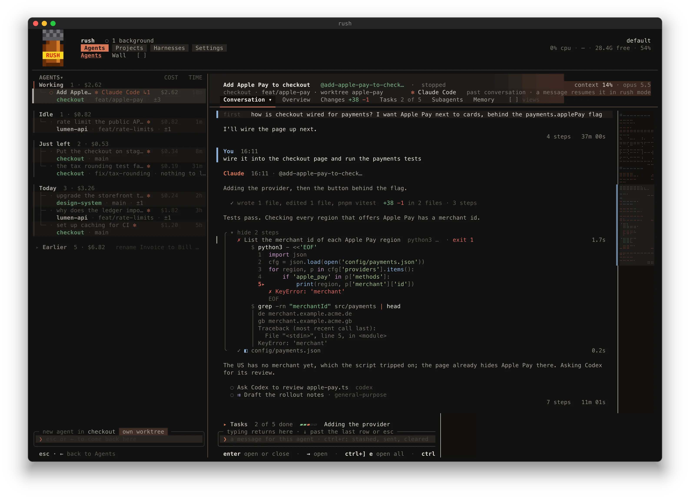
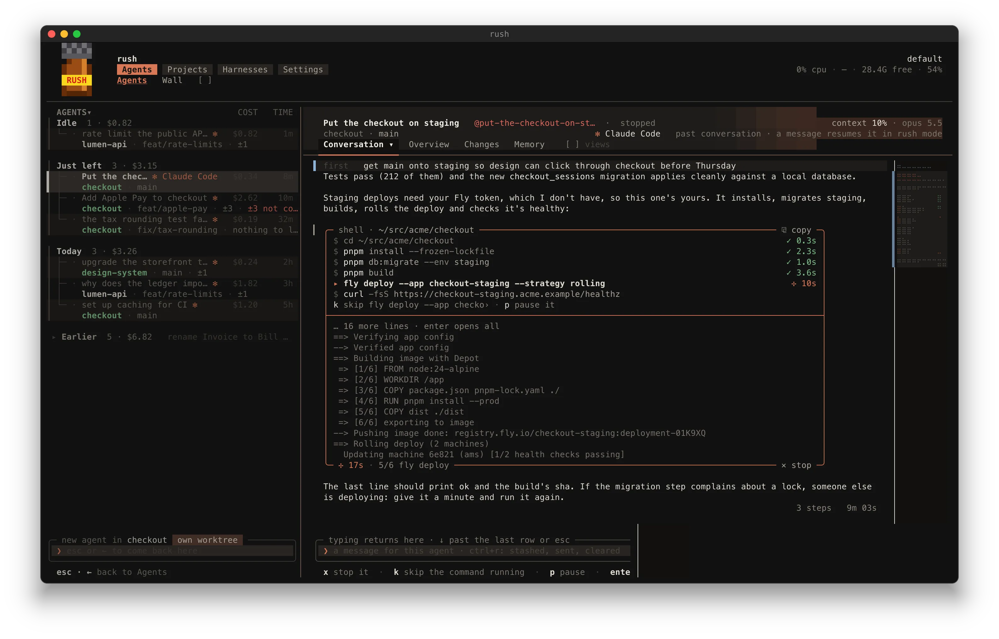
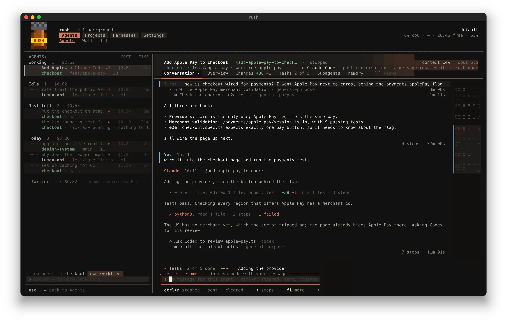
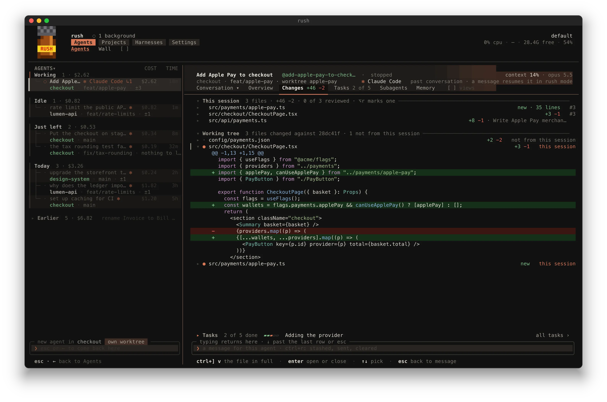
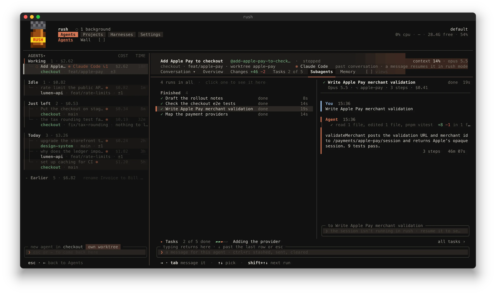
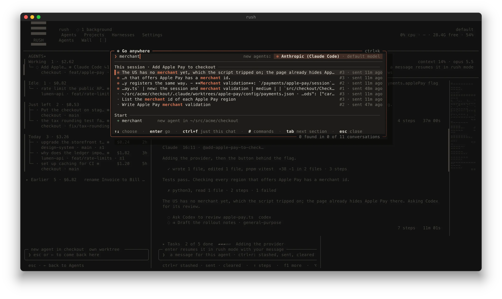

<p align="center">
  
</p>

<h1 align="center">rush</h1>

<p align="center">
  Every coding agent you run, in one terminal app, written in Rust.<br>
  Claude Code, Codex, Copilot, Kimi, Ollama and the rest, side by side, and quick about it.
</p>

<p align="center">
  
</p>

```sh
brew install 0xdeafcafe/tap/rush
rush
```

Use the full name: homebrew/core has a different `rush` (GNU's restricted shell), and plain `brew install rush` gets you that one. Homebrew installs are for Macs with Apple silicon.

On Linux (x86_64 or arm64, glibc 2.35 or newer), take the release's tarball for your machine:

```sh
gh release download --repo 0xdeafcafe/rush --pattern "rush-*-$(uname -m)-unknown-linux-gnu.tar.gz"
tar -xzf rush-*-linux-gnu.tar.gz rush
install -m 755 rush ~/.local/bin/rush
```

Or download it from the [releases page](https://github.com/0xdeafcafe/rush/releases). A rush installed this way updates itself from the releases.

## Fast, on purpose

rush started because Claude Code's own view needed about 330 MB to show me one session. The Rust rush I'm writing this in has been open five hours with 300-odd sessions in its list and sits at 72 MB. Each session's host is about 7 MB, next to the 150-230 MB of the Claude Code it's looking after.

- **A frame costs microseconds.** A warm frame of a 3,000-turn conversation takes about 4 µs, and a cold one under a millisecond. Only the rows on screen are drawn, and a frame that changes nothing isn't written to the terminal at all.
- **Idle means idle.** No ticks, no redraws, no wake-ups while nothing changes. The kernel says when a transcript grew, and only that file is read again.
- **Floods never block typing.** A transcript growing by megabytes is read on a background thread, a slice at a time. Big sessions open at the end first and the rest arrives behind it.
- **Agents don't squat.** When a turn ends and nothing's left running, the agent is stopped a few seconds later and its ~150 MB handed back. Your next message brings it back in about a second, prompt cache intact.
- **Lighter agents, same work.** Codex's app-server runs on macOS's space-efficient allocator: a busy turn peaks at 77 MB rather than 146, idle at 36 rather than 80.
- **Updates don't stop anything.** A new rush installs from the header (`alt+u`) and every session moves onto it between turns: same agent process, same conversation, nothing lost.

`rush --soak 30s 200x50` measures it against your own agents, if you don't believe me.

## One box, three prefixes

Type and press enter: that's a new agent. Everything else hangs off the same box.

- `/` is the agent's: its commands and skills, with Claude Code's own (`/context`, `/rewind`, `/fork`, `/btw`) drawn properly.
- `#` is rush's: `#new`, `#use`, `#fork`, `#remember`, `#discuss` and plenty more, each completing as you type.
- `!` runs a shell command of your own, right there in the conversation, without waiting for the agent or interrupting it.
- `@` tags another agent or a file.
- `ctrl+k` goes anywhere: an agent, a view, turn `#12`, or a search across every transcript you've got (`in:name`, `is:failed`, `file:x`).
- `#ask` asks rush about itself, and can change its settings for you.

## Commands you run where you read them

When an agent needs you to run something (a deploy, a sign-in, anything that needs your machine or your say-so), it doesn't hand you a wall of text to copy into another tab. Its shell block is a box: `▶ run`, `✎ edit` or `⧉ copy`, right where you're reading.

<p align="center">
  
</p>

Every command in the box gets its own line with a tick and how long it took, the one running now is marked with its clock going, and the output streams underneath. `k` skips the command it's stuck on and lets the rest carry on, `p` pauses it, `x` stops it, `enter` opens everything it wrote and `c` copies the commands exactly as written.

When it's done, short output goes back to the agent by itself. Longer output waits for you: `→ send` hands over the last 80 lines, `✎ draft` drops it in your message to trim first, and `≈ summary` has a quick model boil it down to what passed, what failed and where. Runs live in a process of their own too, so quitting rush mid-deploy doesn't kill the deploy.

The agent's own commands get the same treatment: they read as what they do, a long chain says which step it's on, and `k` cuts loose the one that's hung.

## Agents that draw

Agents in rush get more than a stream of markdown to talk to you with.

- **Views.** A panel beside the conversation the agent fills with live state: a test run as it lands, a migration across 30 services, a PR's checks, a list it was handed to work through. Tables you can sort, charts, checklists you can tick, boards, timelines, and buttons that do what the agent wrote on them. A view greys out when it goes stale and tidies itself away.
- **Decision cards.** When an agent needs you to choose, you get a card: each decision with its options, a preview of what each one gets you, and the agent's picks. Answer `1a 2b` and carry on, from the session or straight from its tile on the Wall.
- **Drawings.** Diagrams, layouts and trees in a frame of their own, full width, never wrapped, copyable whole.
- **Needs you.** The bit of a finished turn that's actually waiting on you gets a section of its own, so you don't have to dig the question out of four paragraphs.

## Five ways to read a conversation

One conversation, five questions. `alt+s` flips between them.

- **Normal**: everything. Steps fold away, code's highlighted, a failed step shows the line that says why.
- **Chat**: what did we say? Your messages and the agent's words in bubbles, no steps.
- **Code**: what did it change? Each turn's diffs, and every test, build and lint it ran with its result (and "→ passed next run" when it was fixed later).
- **Catch-up**: what happened while I was away? One card for everything since you last looked: what needs you, what's done, what changed, what's still going.
- **Trail**: where did the time go? Every step on a time axis, the slow one marked, and the turn split into thinking, tools and waiting on you.

Around them sit **Changes** (every file the session touched, which turn wrote each hunk, your review marks), **Subagents** (every run and workflow, with its own conversation a click away), the **queue** (messages sent mid-turn, to edit, reorder, merge or send now) and **Memory**.

## Switching, without losing your place

- `ctrl+tab` flips between open chats, `ctrl+n` jumps to the next one that needs you.
- **The grid** (`ctrl+]` then `|` or `-`) pins agents as live tiles beside the one you're in. Type into a tile where it sits.
- **The Wall** is every agent at once, streaming.
- **Harnesses.** `#use codex` moves the open session to Codex. `#fork codex` copies it there and keeps both, picking up with what changed and what's left. `#new codex@openai-sub gpt-6-astra high fix the test` starts one anywhere, once.
- **Accounts.** Every sign-in per provider, with its limits. Switch and each session moves over between turns, conversation and queue included. rush switches for you as late as it safely can, and at a limit it waits, tries another account or hands the conversation to the next provider.

## For people who live in it

- **Every key moves.** Settings › Keys rebinds anything, chords included, and every `#` command can have a key of its own.
- **Drafts never die.** `ctrl+p` stashes what you've typed, `ctrl+r` brings back anything you stashed, sent or cleared, across restarts.
- **The guide** (`alt+/`) is a fast model floating over everything that can see your sessions. Ask "what's next?" and it opens the one that needs you.
- **Rooms.** `#discuss` puts a panel of fresh agents on the open chat to argue it out, and the verdict comes back as a card to send on. `#intervene` gets two agents to work out why one's stuck.
- **Spend less.** rush keeps an idle session's prompt cache warm for about a tenth of its price, refuses an agent re-reading a file that hasn't changed, and the runaway guard stops a busy afternoon spending a week's limit.
- **Memory.** `#remember <what>` writes a note with a cheap model and asks before keeping it. The Memory view shows how often each note is actually opened, and a review finds the stale ones.
- **Pull requests.** `rush pr follow 1234` gives an agent what's left before merge, in order, then wakes it only with news it can act on: a failed check with its log, a trusted review finding, a conflict. Comments from outside the repo never reach it. `rush watch pr` waits on checks without polling GitHub.
- **Agents running agents.** Any agent can hand work to another on any provider (Claude asking Codex for a second opinion, say), filed under its parent with what it was asked.
- **Projects.** Every repo and worktree with its branch, its agents and whether removing it would lose anything, plus what finished sessions left running.
- **Reminders and the feed.** Agents set themselves a wake-up, and chirp at each other before starting something heavy.
- **The menu bar** (`rush menubar`) has every account's limits and the agents waiting on you, and you can answer their questions from the notification.

rush never ends an agent on its own: no idle kills, no token ceilings, no restarts when a new rush lands. A session stops when you close it or its agent exits.

<table>
  <tr>
    <td width="50%"></td>
    <td width="50%"></td>
  </tr>
  <tr>
    <td></td>
    <td></td>
  </tr>
</table>

## Providers

rush runs anything it has an adapter for, and only shows the ones you've got installed.

| provider | how | support |
| --- | --- | --- |
| Claude Code | headless, hosted by rush | full |
| Codex | `codex app-server` | tested |
| Copilot | Copilot CLI, via `gh`'s token | tested |
| Kimi | Agent Client Protocol, Kimi Code 2 history | tested |
| Antigravity (`agy`) | persistent streaming JSON | preview |
| OpenCode, Vibe | Agent Client Protocol | preview |
| DeepSeek | `dsh` | preview |
| GLM | ZCode, via `zcode-acp-server` | preview |
| Ollama | Claude Code on Ollama, tuned per model | preview |

Full is what I use every day, tested has been run against the real thing, and preview is built but hasn't met it yet.

Ollama sessions get a prompt cut down to the six file and shell tools, and nothing reaches Anthropic. On an M1 Max with `qwen3-vl:30b` that took the prompt from 14k tokens to 4k, and the first answer from over a minute to about seven seconds.

## Plugins

Plugins add tools, subagents, prompt text, views and commands, and can run agents of their own (any MCP server can be one). Each one is sandboxed to its own files and the hosts it named, with no programs, and `rush plugin approve` reads you its limits before you say yes. More in [plugins/](plugins).

## Embedding

Other apps can run sessions headless and follow them as they work, a line of JSON per event.

```sh
rush session start --cwd DIR [--agent A] --json
echo 'next message' | rush session send <id>
echo 'Coffee' | rush session answer <id>
rush session watch <id> --json --until-idle
rush open <id> --hosted
```

The format is in the [guide](docs/guide.md#embedding-rush).

## Building it yourself

```sh
git clone https://github.com/0xdeafcafe/rush
cargo install --locked --path rush/crates/rush
```

That needs stable Rust and puts `rush` in `~/.cargo/bin`. A rush built this way doesn't update itself: pull and build it again.

## How it works

rush reads Claude Code's files (job state, roster, transcripts) and only changes things through Claude Code itself, via its daemon socket or the CLI. The one exception is switching accounts, which writes the sign-in into Claude Code's keychain item and `~/.claude.json`. Other agents go through adapters (`crates/rush-codex`, `rush-acp` and the like).

None of that is documented and any Claude Code update can move it, so rush is checked against Claude Code v2.1.280. If an update breaks something, the affected column shows `–` and opening an agent falls back to `claude attach`. Costs are estimated at list prices, so your bill might disagree.

[docs/guide.md](docs/guide.md) is the full manual, and it's what `#ask` reads. [DESIGN.md](DESIGN.md) has how it's built and the numbers behind every speed claim. `rush on` makes `claude agents` open rush, `rush off` gives it back, and `rush update` fetches a fresh bottle.

Sold as an AI harness polisher. Not for agent consumption.

## License

[WTFPL](LICENSE). Do what the fuck you want to.
